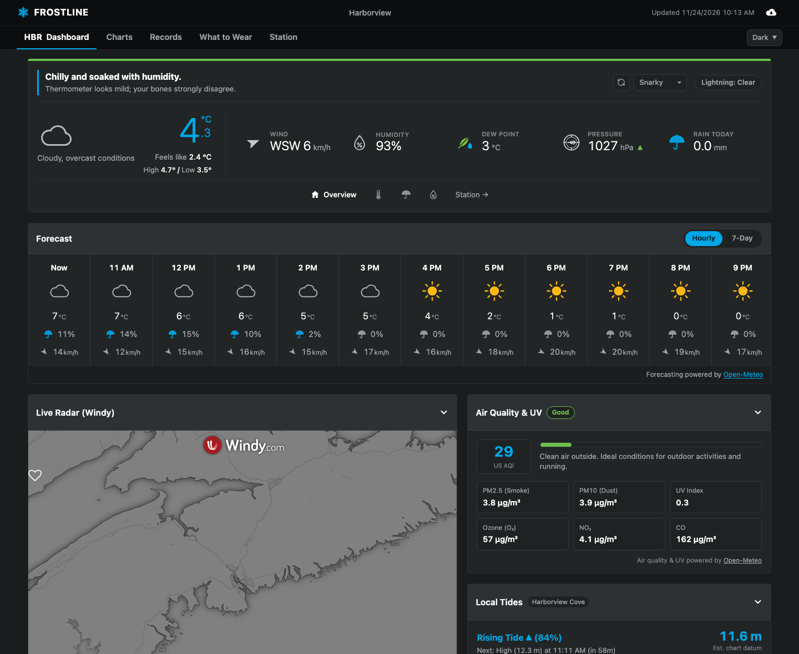
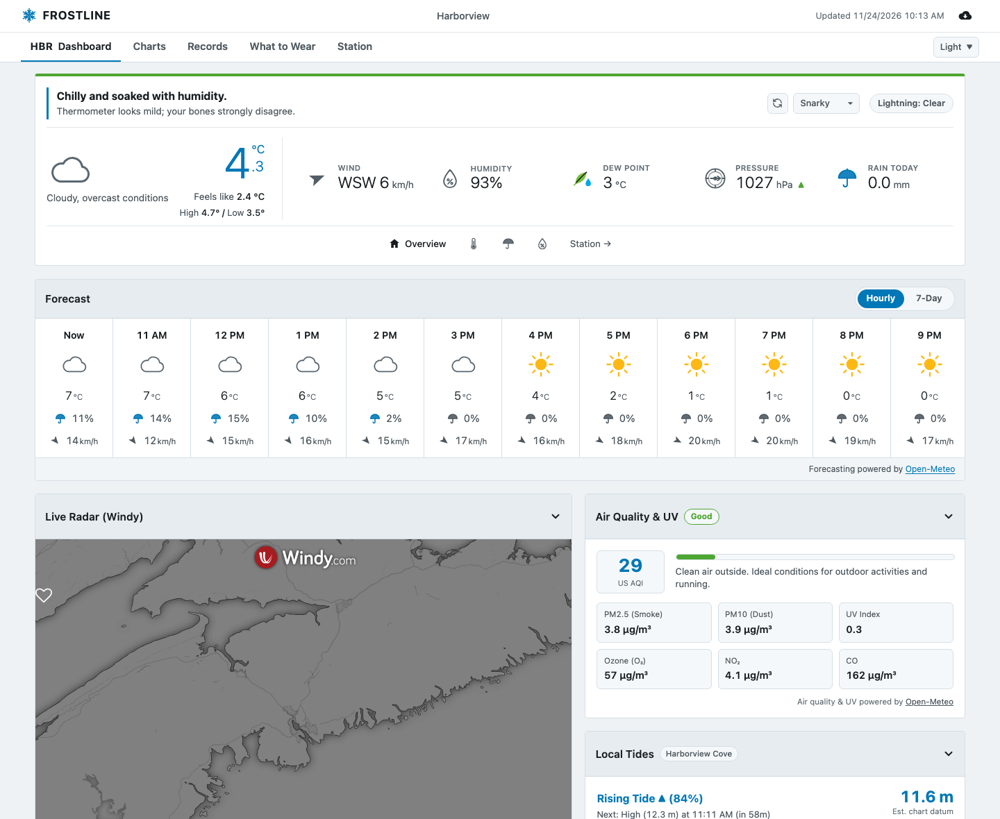
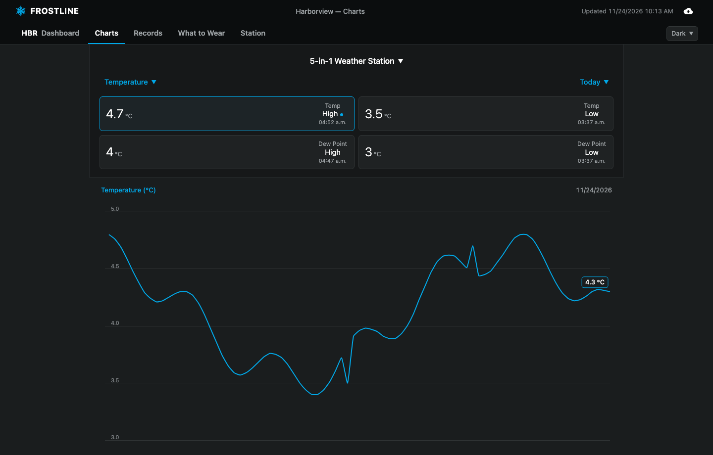
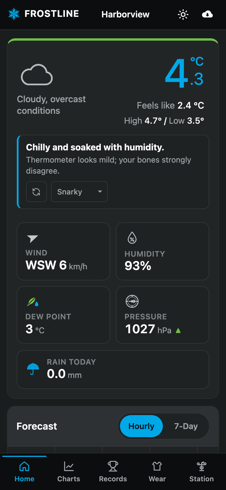

# Frostline — WeeWX v5 Skin

[](https://glasspear.github.io/weewx-frostline/)
[](https://weewx.com/)
[](LICENSE)

A clean, responsive adaptive dark/light **WeeWX v5** weather station skin inspired by modern console dashboards, featuring interactive Chart.js v4 historical graphs, live **Weather Alerts** (US NWS & Environment Canada), **Open-Meteo** hourly/7-day forecasts and Air Quality, embedded **Windy.com** live radar, tidal curves, **All-Time Records**, multi-sensor diagnostics, and a configurable **What to Wear** guide.

**[View the Interactive Live Demo on GitHub Pages &rarr;](https://glasspear.github.io/weewx-frostline/)**

---

## Screenshots

### Desktop — Dark & Light Modes

| Dark Mode (Default / Auto) | Light Mode |
| :---: | :---: |
|  |  |

### Interactive Charts & Mobile Layout

| Interactive Charts (`charts.html`) | Mobile Dashboard (`index.html`) |
| :---: | :---: |
|  |  |

---

## Important Notices

> **No Individual Support Disclaimer**  
> This skin was built primarily for my own personal weather station and is shared **as-is** under the MIT License. I do not provide individual setup, hardware debugging, or troubleshooting support. Pull requests and reproducible bug reports on GitHub are welcome on a best-effort basis.

> **AI-Assisted Development Disclosure**  
> Portions of Frostline's templates, JavaScript, and CSS were built with AI assistance ("vibe-coded") and are backed by an automated Python + Node.js test suite (`./scripts/run_tests.sh`). Please review the code and test on a non-root `HTML_ROOT` (`public_html/frostline`, the default) before deploying to your live site.

> **Privacy Note for Station Owners**  
> Frostline fetches client-side forecasts, Air Quality, Weather Alerts, and renders the Windy.com radar embed directly in the visitor's browser using the latitude and longitude configured in your `weewx.conf` (embedded into the generated HTML/JSON). If you publish your station publicly and want extra location privacy, consider rounding your `[Station]` coordinates in `weewx.conf` (e.g. to 2 decimal places).

---

## Features

- **Adaptive Dark/Light Theme:** Follows the visitor's system `prefers-color-scheme` (`Auto`) or switches cleanly between `Dark` and `Light` from the top bar without flash on load.
- **Dashboard (`index.html`):**
  - Hero temperature card with stacked decimals, Feels Like, High/Low, barometer with 3-hour trend arrow, humidity, wind direction & speed, daily rainfall (`mm` or `in`), and clickable quick-jump metric icons.
  - Inline Weather Commentary bar (`Clean`, `Snarky`, or `Unfiltered` tones) and live US NWS / Environment Canada Weather Alerts banner with 3-day browser alert history.
  - Persistent **Hourly | 7-Day** Open-Meteo forecast toggle with weekly min/max temperature range bars (no API key required).
  - Embedded **Windy.com** live radar map (`radar`, `wind`, `temp`, `rain`, `clouds`, `pressure`), Air Quality & UV card (`US AQI`, `CA AQHI`, or `EAQI`), and toggleable Local Tides card (DFO CHS IWLS, US NOAA CO-OPS, or offline lunar harmonic model).
- **Interactive Charts (`charts.html`):**
  - Chart.js v4 (loaded with Subresource Integrity `integrity` + `crossorigin="anonymous"`, plus a zero-dependency offline Canvas 2D fallback in `assets/js/chart-fallback.js`).
  - Dual-series Rain Accumulation + Interval Rain overlay, Lightning strikes & distance, Wind Speed/Gusts, Temperature, Dew Point, Humidity, and Barometer across `Today`, `Week`, `Month`, and `Year`.
- **Weather Records (`records.html`):**
  - `All-Time`, `This Year`, `This Month`, and `Today` extremes for outdoor sensors, optional secondary sensors, and lightning activity.
- **What to Wear (`wear.html`):**
  - **Regular Day** practical layering guide enabled by default, plus optional **Running Kit** (thermal preference & intensity controls) and **Search & Rescue (GSAR 12-Hour Callout)** wear-vs-pack planner toggled via `weewx.conf`.
- **Station & Diagnostics (`station.html`):**
  - Per-station cards with embedded `OK` / `Offline` connection health, RF signal (`rxCheckPercent`), battery status, console voltage, `extra_sensors` support, and sun/moon location telemetry.

---

## Installation (WeeWX v5)

### Option 1: Install as a WeeWX Extension (Recommended)

Install directly using `weectl` (this installs into `skins/frostline/` and sets `HTML_ROOT = public_html/frostline` so it never overwrites your existing root WeeWX site):

```bash
weectl extension install https://github.com/glasspear/weewx-frostline/releases/download/v1.1.0/weewx-frostline-v1.1.0.tar.gz
```

Or download a release tarball locally and run:

```bash
weectl extension install weewx-frostline-v1.1.0.tar.gz
```

Then run a report cycle to generate the site:

```bash
weectl report run Frostline
```

Your Frostline dashboard will be generated in `public_html/frostline/`.

### Option 2: Manual Installation

1. Clone this repository and copy `frostline/` into your WeeWX `skins/` directory:
   ```bash
   git clone https://github.com/glasspear/weewx-frostline.git
   cp -r weewx-frostline/frostline ~/weewx-data/skins/frostline
   # (For Debian/Ubuntu/RPM package installs, copy to /etc/weewx/skins/frostline with sudo)
   ```
2. Add a `[[Frostline]]` report stanza under `[StdReport]` in `weewx.conf`:
   ```ini
   [StdReport]
       [[Frostline]]
           skin = frostline
           HTML_ROOT = public_html/frostline
           enable = true
           [[[Extras]]]
               station_code = ""
               show_secondary = false
               show_lightning = false
               show_tides = false
               show_air_quality = true
               show_wear_running = false
               show_wear_sar = false
               rain_units = auto
               alerts_provider = auto
               aqi_standard = auto
   ```
3. Restart WeeWX (`sudo systemctl restart weewx` or `docker restart weewx`) and run `weectl report run Frostline`.

### Serving Frostline at Your Site Root (`/`)

Once you've verified Frostline looks right at `/frostline/`, you can make it your primary root dashboard:

```ini
[StdReport]
    [[SeasonsReport]]
        skin = Seasons
        enable = false

    [[Frostline]]
        skin = frostline
        HTML_ROOT = public_html
        enable = true
```

---

## Configuration Options (`[[[Extras]]]`)

Override any of these under `[StdReport] -> [[Frostline]] -> [[[Extras]]]` in `weewx.conf`:

| Option | Default | Description |
| :--- | :--- | :--- |
| `station_code` | *(empty)* | Short station badge in the top nav bar (falls back to `$station.location` if blank). |
| `brand_prefix` | *(empty)* | Optional italic prefix before the wordmark. |
| `brand_primary` | `FROST` | First half of the wordmark. |
| `brand_secondary` | `LINE` | Second half of the wordmark. |
| `primary_sensor_title` | `5-in-1 Weather Station` | Primary outdoor sensor title on `Station` and `Charts`. |
| `secondary_sensor_title` | `Lightning Tower` | Secondary sensor title (`extraTemp1` / `extraHumid1`, falling back to `inTemp` / `inHumidity`). |
| `show_secondary` | `true` (`false` via installer) | Show/hide the secondary sensor card on `station.html`. |
| `extra_sensors` | *(empty)* | Comma-separated extra stations (`Title:tempObs:humidObs:batteryObs`, e.g. `Greenhouse:extraTemp2:extraHumid2:batteryStatus2`). |
| `show_lightning` | `true` (`false` via installer) | Show/hide lightning counts, distance, hero badge, and lightning health metrics. |
| `show_alerts` | `true` | Enable the live US NWS / Environment Canada Weather Alerts banner. |
| `alerts_provider` | `auto` | `auto` (US NWS vs Environment Canada by lat/lon), `us`, or `canada`. |
| `show_forecast` | `true` | Enable the Open-Meteo Hourly / 7-Day forecast card. |
| `show_windy` | `true` | Enable the Windy.com radar embed (`windy_overlay`, `windy_zoom`). |
| `show_air_quality` | `true` | Enable the Air Quality & UV card. |
| `aqi_standard` | `auto` | `auto`, `us_aqi`, `ca_aqhi` (Canadian 1-10+), or `european_aqi`. |
| `show_tides` | `true` (`false` via installer) | Show/hide the Tides card (disable for inland stations). |
| `tide_provider` | `auto` | `auto`, `dfo` (Fisheries & Oceans Canada IWLS), `noaa` (US NOAA CO-OPS), or `harmonic`. |
| `tide_units` | `auto` | `auto` (`ft` for Fahrenheit stations, `m` for Celsius), `m`, or `ft`. |
| `tide_title` | `Local Tides` | Header title for the Tides card. |
| `tide_station_name` | `Local Harbour` | Station label pill in the Tides card header. |
| `tide_station_code` | *(empty)* | Optional CHS station code for DFO attribution. |
| `tide_station_id` | *(empty)* | DFO IWLS hex ObjectId or 7-digit US NOAA CO-OPS ID (e.g. `8410140`). Empty uses the harmonic model. |
| `show_quip` | `true` | Show/hide the inline weather commentary bar (`quip_tone`: `clean`, `snarky`, `unfiltered`). |
| `show_station_health` | `true` | Show/hide embedded telemetry/health panels on `station.html`. |
| `show_wear_running` | `false` | Enable the configurable **Running Kit** card on `wear.html`. |
| `show_wear_sar` | `false` | Enable the **Search & Rescue (GSAR 12-Hour Callout)** card on `wear.html`. |
| `rain_units` | `auto` | `auto` (`in` for US Imperial, `mm` for metric/cm), `mm`, or `inch`. |
| `stale_threshold_minutes` | `15` | Minutes without an archive update before sensor cards flag `Offline`. |
| `asset_version` | `20261124-1` | Cache-busting query string for CSS, JS, and icons. |
| `chartjs_cdn` | jsDelivr Chart.js 4.4.7 | CDN URL for Chart.js v4 (`chart-fallback.js` renders offline). |
| `chartjs_sri` | SHA-384 hash | Subresource Integrity hash applied automatically when using the default Chart.js CDN URL. |

---

## Development, Testing & Release Packaging

You can test templates, JavaScript logic, and preview builds locally without installing WeeWX:

```bash
# Run unit tests + rebuild preview/
./scripts/run_tests.sh

# Serve the static preview site locally
./.venv/bin/python scripts/build_preview.py --serve 8765

# Build a clean WeeWX extension release tarball under dist/
./scripts/build_release.sh 1.0.0
```

## License

MIT License — see [LICENSE](LICENSE).
